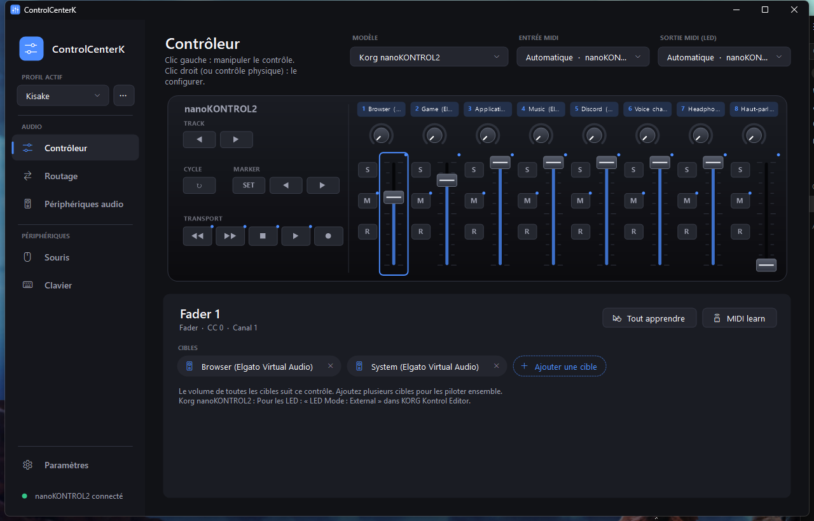
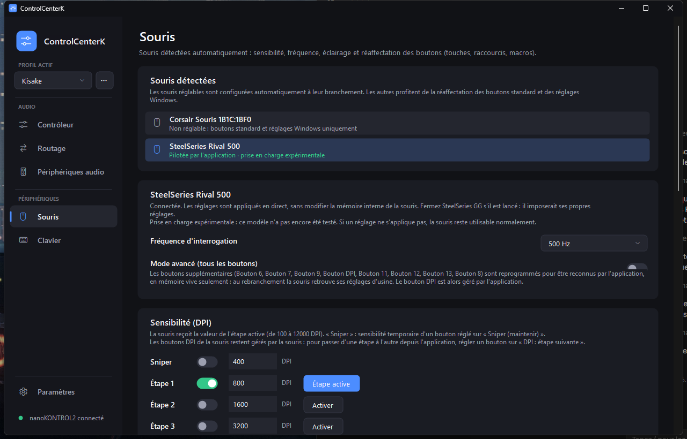
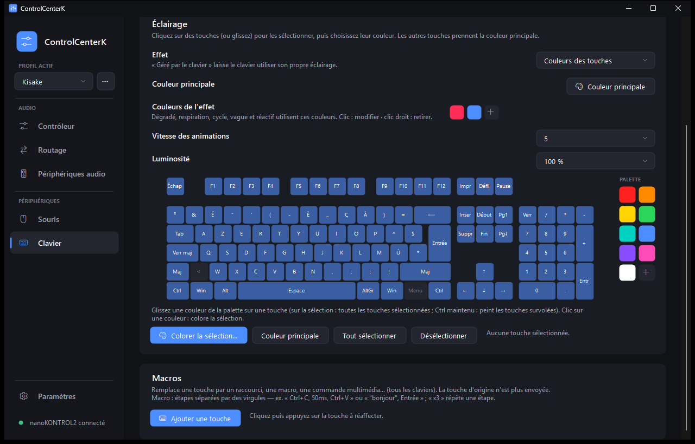

# ControlCenterK

**Le centre de contrôle léger de votre PC Windows : son, contrôleurs MIDI, souris, clavier, affichage en jeu, partage et capture d'écran, réunis dans une seule application sombre, rapide et sans compte.**

ControlCenterK remplace une pile de logiciels (mixeur MIDI, console de routage audio, logiciels de souris et de clavier des fabricants, overlay de FPS, outil de capture d'écran…) par un seul petit exécutable. Il reste discret dans la zone de notification, et chaque fonction est un **module** que l'on active ou non : un module désactivé ne charge rien du tout.

[**⬇ Télécharger la dernière version**](https://github.com/KisakePro/ControlCenterK/releases/latest) · Windows 10 / 11 · installation sans droits administrateur

> La série **0.7** est publiée en **BETA** (« Pre-release ») : [toutes les versions](https://github.com/KisakePro/ControlCenterK/releases).



---

## Les modules

| Section | Module | En bref |
|---|---|---|
| Audio | 🎚️ **Contrôleur MIDI** | le volume de Windows et des applications au bout des doigts |
| Audio | 🔀 **Routage audio** | une console façon Voicemeeter, avec cartes son virtuelles |
| Audio | 🔊 **Périphériques audio** | renommer ou masquer entrées, sorties et applications |
| Périphériques | 🖱️ **Souris** | DPI, fréquence, éclairage, boutons réaffectables |
| Périphériques | ⌨️ **Clavier** | éclairage touche par touche, effets, macros |
| Outils | 📈 **Capteurs** | FPS, CPU, GPU et RAM affichés par-dessus vos jeux |
| Outils | 📡 **Partage d'écran** | une zone de l'écran envoyée à Discord comme une webcam |
| Outils | 📸 **Capture d'écran** | Impr. écran façon ShareX, avec éditeur |

---

### 🎚️ Contrôleur MIDI
Pilotez le volume de Windows avec un contrôleur physique.
- Chaque **fader** ou **potentiomètre** règle une ou plusieurs cibles : sortie ou micro par défaut, un périphérique précis, une application (Discord, Spotify, un jeu…), l'application au premier plan, les sons système…
- Les **boutons** coupent le son, changent le périphérique par défaut, envoient des touches multimédia ou changent de profil.
- **Contrôleur à l'écran interactif** : clic gauche pour bouger un fader ou appuyer sur un bouton, clic droit pour le configurer.
- **Profils** créés, dupliqués, exportés et importés (`.json`), toujours accessibles en haut de la barre latérale.
- **Filtre anti-tremblement**, retour **LED**, courbe de volume, **MIDI learn**.
- Korg nanoKONTROL2 et les contrôleurs MIDI les plus répandus (X-Touch Mini, APC mini…), plusieurs à la fois.

### 🔀 Routage audio
- Envoyez n'importe quelle entrée (micro, ou tout ce qui est joué sur une sortie) vers plusieurs sorties à la fois : casque **et** enceintes, par exemple.
- Gain en dB, muet, vumètres, délai par sortie pour synchroniser les appareils.
- Trois vues : **Console**, **Matrice** et **Cartographie**.
- **Périphériques audio virtuels** : de vraies cartes son (« Haut-parleurs » / « Microphone ») visibles par tous vos logiciels.

### 🔊 Périphériques audio
Entrées à gauche, sorties à droite, applications en dessous : donnez un nom plus court ou masquez ce que vous ne voulez pas voir dans les menus.

### 🖱️ Souris
Branchez une souris : elle est **détectée automatiquement** et configurée.
- **Sensibilité (DPI)** en étapes, mode sniper, **fréquence d'interrogation**, **éclairage** par zone.
- **Boutons réaffectables** : raccourci clavier, macro, clic, média, volume, changement de DPI… « Détecter un bouton » : appuyez, il apparaît dans la liste.
- Raccourcis et macros en **impulsion** (une fois) ou **continu** (tant que le bouton est enfoncé).
- Chaque modèle garde ses réglages ; les souris débranchées ou supprimées de la liste se gèrent en bas de page.

| Marque | DPI | Fréquence | Éclairage | Boutons supplémentaires |
|---|:-:|:-:|:-:|:-:|
| Corsair (Nightsword, M65, Scimitar, Ironclaw…) | ✔ | ✔ | ✔ | ✔ |
| SteelSeries (≈ 70 modèles : Rival, Sensei, Aerox, Prime…) | ✔ | ✔ | selon le modèle | ✔ |
| Razer (≈ 90 modèles : DeathAdder, Viper, Basilisk…) | ✔ | ✔ | logo / molette | — |
| Logitech G (filaires et Lightspeed) | ✔ | ✔ | — | — |
| Toutes les autres souris | boutons milieu / précédent / suivant / molette inclinée, réglages Windows |||



### ⌨️ Clavier
- **Éclairage touche par touche** sur un clavier dessiné à l'écran (AZERTY / QWERTY, claviers ISO et ANSI).
- **Palette de couleurs** à glisser sur les touches, **effets** avec vos couleurs : dégradé, respiration, cycle, vague, arc-en-ciel, réactif.
- **Macros sur n'importe quelle touche ou combinaison** (Ctrl+A, Ctrl+Maj+F1…), pour tous les claviers, en impulsion ou en continu.

| Marque | Éclairage |
|---|---|
| SteelSeries Apex (M750, 5, 7, 9, Pro) | touche par touche |
| Corsair K65 / K70 / K95 / Strafe RGB | tout le clavier |
| Razer | tout le clavier |
| Tous les claviers | macros |



### 📈 Capteurs (affichage en jeu)
Un affichage discret par-dessus les jeux que vous choisissez :
- **FPS** exacts, mesurés par les événements de Windows (DirectX 9 à 12, Vulkan, OpenGL) **sans rien injecter dans le jeu**, avec une courbe pour repérer les chutes.
- **Processeur**, **carte graphique** et **mémoire vive** : utilisation, température et courbe de 0 à 100 %.
- Couleur, taille, coin de la fenêtre, décalages, durée des courbes, opacité du fond ; réglages par défaut et **réglages propres à chaque jeu**. L'affichage reste visible sur le jeu pendant qu'on le règle, avec un aperçu.
- Températures : la carte graphique est lue par le pilote AMD ou NVIDIA ; celle du processeur (Ryzen) par une petite **sonde** installée en un clic, qui s'appuie sur [PawnIO](https://pawnio.eu) (pilote signé et open source). HWiNFO est aussi reconnu s'il partage ses capteurs.

### 📡 Partage d'écran
Partagez **une zone de l'écran sur Discord comme une webcam** (« KStS Virtual Screen », 1920 × 1080, 30 images/s, curseur compris).
- Installation de la caméra virtuelle en un clic.
- **Zones enregistrées**, chacune avec sa couleur, choisies à la souris sur tous les écrans ou par coordonnées.
- **Passage d'une zone à l'autre en direct**, sans couper la caméra ; raccourcis **Ctrl+Alt+F1…F9** (zones) et **Ctrl+Alt+F10** (arrêt), désactivables.
- Cadre coloré autour de la zone partagée (hors image), et option pour afficher toutes les zones à la fois.

### 📸 Capture d'écran
Comme ShareX :
- **Impr. écran** fige l'écran : glisser = zone, clic = fenêtre, Entrée = écran entier. **Ctrl+Impr** = écran sous la souris, **Alt+Impr** = fenêtre active.
- Un **menu** apparaît à côté de la sélection : copier, enregistrer, copier et enregistrer, enregistrer sous, ouvrir l'éditeur.
- **Éditeur** : rectangle, flèche, crayon, surligneur, texte, floutage, couleur, épaisseur, annuler / rétablir.
- Dossier, nom des fichiers, PNG ou JPEG, action par défaut, liste des dernières captures.

### 🎨 Et aussi
- **Thème sombre** personnalisable : couleur d'accent, teinte du fond, thèmes enregistrés.
- **Mises à jour** intégrées depuis GitHub (empreinte SHA-256 vérifiée), avec choix de la version à installer pour **revenir en arrière** si besoin.
- Réglages dans un dossier `config` à côté de l'application (emplacement modifiable).

---

## Installation

1. Téléchargez `ControlCenterK-Setup.exe` depuis la [dernière version](https://github.com/KisakePro/ControlCenterK/releases/latest).
2. Lancez-le : installation pour votre utilisateur, sans droits administrateur, avec raccourcis et démarrage avec Windows en option.
3. Activez les modules qui vous intéressent dans **Paramètres → Modules**.

Fermer la fenêtre ne quitte pas l'application : elle reste dans la zone de notification (clic pour l'ouvrir, clic droit → Quitter).

> **Bon à savoir**
> - Fermez les logiciels des fabricants (iCUE, G HUB, Synapse, SteelSeries GG) : ils imposeraient leurs propres réglages.
> - Les réglages de souris et de clavier sont envoyés **en direct** : rien n'est écrit dans la mémoire interne de vos périphériques.
> - Les modèles non testés sont signalés « expérimental » dans l'application.
> - Quelques fonctions demandent une confirmation administrateur **une seule fois** : caméra virtuelle du partage d'écran, sonde de température du processeur.
> - L'affichage en jeu fonctionne en fenêtré et en plein écran fenêtré (le plein écran exclusif masque les fenêtres par-dessus).
> - Les périphériques audio virtuels utilisent le pilote libre [usbip-win2](https://github.com/vadimgrn/usbip-win2), à installer une fois.

---

## Pour les développeurs

Aucun outil à installer : le projet se compile avec le compilateur C# fourni avec Windows (.NET Framework 4.8).

```bat
build.cmd
```

- `bin\ControlCenterK.exe` : l'application (un seul fichier, utilisable sans installation)
- `dist\ControlCenterK-Setup.exe` : l'installateur

```
src/Engine.cs, Midi.cs, CoreAudio.cs   contrôleurs MIDI et volumes Windows (WASAPI)
src/Router/                            routage audio et périphériques virtuels
src/Mouse/                             détection et pilotes des souris
src/Keyboard/                          détection, pilotes et effets des claviers
src/Fps/                               capteurs : FPS (ETW), CPU / GPU / RAM, sonde PawnIO, affichage en jeu
src/Share/                             partage d'écran : caméra virtuelle, zones
src/Capture/                           capture d'écran : écran figé, menu, éditeur
src/UI/                                interface
setup/                                 installateur
```

**Publier une version** : modifier `src/Version.cs`, ajouter la section correspondante dans `CHANGELOG.md`, puis pousser un tag `vX.Y` : GitHub Actions compile et publie la release.

## Remerciements et licences tierces

- Protocoles des périphériques : [OpenRGB](https://gitlab.com/CalcProgrammer1/OpenRGB), [openrazer](https://github.com/openrazer/openrazer), [rivalcfg](https://github.com/flozz/rivalcfg), [libratbag](https://github.com/libratbag/libratbag), [ckb-next](https://github.com/ckb-next/ckb-next).
- Caméra virtuelle : module caméra virtuelle d'[OBS Studio](https://github.com/obsproject/obs-studio) (GPL-2.0), embarqué.
- Sonde de température : [PawnIO](https://github.com/namazso/PawnIO) et son module `AMDFamily17` ([PawnIO.Modules](https://github.com/namazso/PawnIO.Modules), LGPL-2.1), embarqué.
- Mesure des FPS inspirée de [PresentMon](https://github.com/GameTechDev/PresentMon).
